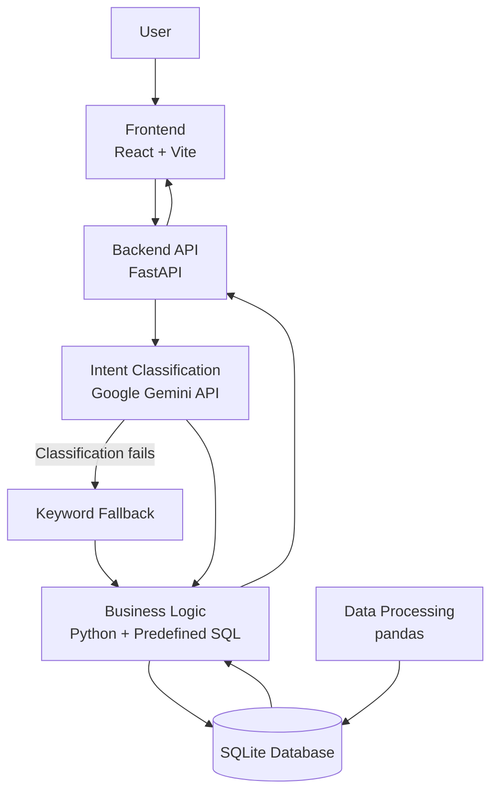

# System Architecture

## Mini AI Business Intelligence Assistant

The application follows a layered architecture that separates the frontend, backend processing, AI-based question classification, and database operations.

## 1. Architecture Diagram

## 2. Components

**Frontend — React and Vite**

Provides the dashboard, KPI cards, question input, and display of analytical results.

**Backend — FastAPI**

Receives user questions, validates requests, coordinates classification and query execution, and returns responses to the frontend.

**AI Classification — Google Gemini API**

Identifies the intent of a natural-language question, such as total revenue, highest-revenue product, monthly trend, regional sales, or month-to-month comparison. A keyword-based fallback is available when Gemini classification fails.

**Business Logic — Python and SQL**

Maps supported intents to predefined, parameterized SQL queries. Business calculations use database data rather than AI-generated numerical answers.

**Database — SQLite**

Stores processed sales transactions and provides the data used for analytical queries.

**Data Processing — pandas**

Loads and cleans the sales CSV, handles duplicate and invalid records, and identifies transactions that should be excluded from revenue calculations.

## 3. Request Flow

1. The user submits a question through the frontend.
2. FastAPI validates the request and obtains an analytical intent.
3. The application maps the intent to a predefined SQL query.
4. SQLite retrieves the required data for the calculation.
5. FastAPI returns the answer and supporting information.
6. The frontend displays the results.

## 4. Design Principle

AI interprets the user's question, while predefined SQL queries and validated sales data handle the business calculations. This separation helps make the results consistent, transparent, and easier to verify.